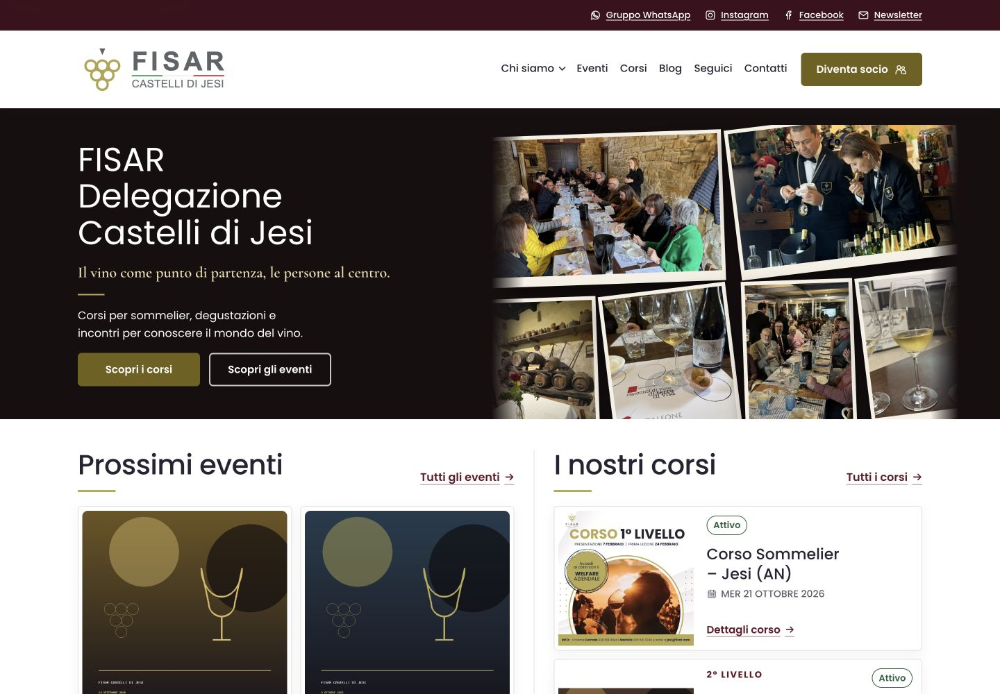
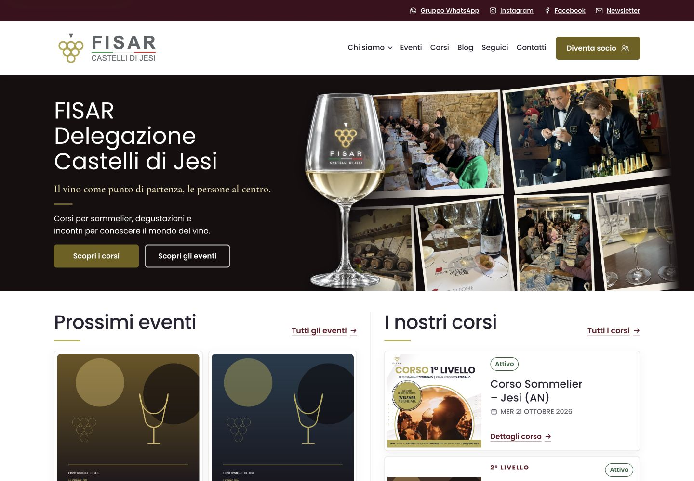

# Alternative della hero — 15 ottobre 2026

**25 ottobre — quarto collage:** E estesa a 24 scatti distinti e quattro gruppi, con la selezione 1, 2, 4, 5, 6, 8 dell’utente. Primi tre collage preservati; nuovo gruppo in fondo alla galleria locale e Aruba, quarto pallino automatico. Tema, layout, calice e breakpoint invariati; nessun nuovo deploy di codice su Aruba.

**Stato finale del 24 ottobre: E applicata alla Home locale e all’anteprima Aruba, tema 1.6.99.** Tre collage da sei, fotografie native nella Libreria media di ciascun ambiente, comandi solo pallini/pausa, album nascosto sotto 1024 px. Nessun import del database locale, nessuna modifica al sito pubblico precedente. Le note sotto documentano le prove storiche; provino pulito e alternative restano disponibili.

**24 ottobre — versione E confermata:** l'indirizzo principale mostra l'anteprima pulita, senza comandi o note di test; mantenuti solo pallini e pausa del carosello. Alternative conservate in `hero-2026-10-23/confronto.html`. Tutte le 27 foto archiviate integralmente in `assets/photography/sito-home/originals/`, incluse quelle non selezionate e la copia duplicata; esclusa solo la cache `Thumbs.db`. Inventario e rigenerazione documentati nella stessa cartella. Approvazione visiva, non ancora applicazione a WordPress/Aruba.

Ultima regola responsive E del 24 ottobre: collage, calice e controlli visibili solo da 64rem (1024 px), a destra del titolo; sotto questa soglia nascosti senza lasciare spazio vuoto. Automatismo sospeso mentre nascosti. Supera le precedenti composizioni E sotto il testo su mobile/tablet; A–D e WordPress/Aruba invariati.

Ultima rifinitura E del 24 ottobre: controlli allineati a destra sotto le foto, ravvicinati (130 px totali), oro-grigio meno luminoso anche sulla pausa. Bersagli 32 px, icone 6/8/16 px, focus e nomi accessibili conservati; nessun box. Provino locale soltanto, Aruba invariato.

## Nuove selezioni fotografiche — 23 ottobre 2026, in valutazione

Tre varianti del collage con gli scatti forniti dall’utente, mantenendo il calice naturale e il layout approvati: **A Persone e convivialità**, **B Imparare e condividere**, **C Cantina e incontri**. [Provino, provenienza e verifiche](hero-2026-10-23/README.md). Proposte isolate: nessuna sostituzione ancora effettuata nella Home locale o Aruba; le opzioni precedenti sotto restano conservate.

Aggiunta su richiesta la **D Album in movimento**: dodici fotografie uniche, striscia continua con calice/testi fermi, pausa e frecce, rispetto del movimento ridotto. Stessa altezza, nessuna libreria o clone fotografico. Anche D resta nel solo provino, non applicata al sito.

Alternativa **E Carosello di collage**, corretta sul chiarimento dell’utente: due collage di sei foto ciascuno, dodici immagini senza ripetizioni tra i gruppi. Ogni collage resta fermo e cambia dopo sei secondi con dissolvenza; frecce/indicatori/pausa, calice e geometria originali. Superata e sostituita la prova erronea a foto singola. Le cinque proposte restano confrontabili nel solo provino locale, con stessa altezza e rispetto del movimento ridotto.

**Aggiornamento più recente di E:** tre collage da sei foto, diciotto sorgenti uniche, dopo la richiesta di 3–4 collage differenti. Rimossi box, frecce e pallini dalla hero; resta soltanto una piccola icona pausa/riprendi accessibile. Scelta manuale tramite selettore nel pannello del solo provino. Sei WebP aggiunti dalla cartella fornita, originali intatti; A/B/C/D e Aruba invariati.

**24 ottobre — controlli approvati in prova:** tre pallini cliccabili centrati sotto il collage, attivo pieno oro e altri vuoti, pausa/riprendi accanto. Nessun box o freccia; bersagli da 44 px e nomi/focus accessibili. Fascia riservata sotto le foto senza aumentare la hero; scelta manuale ferma l’automatismo, pallini utilizzabili anche con movimento ridotto. Supera la precedente sola pausa; resta una prova locale, non applicata ad Aruba.

## Opzione 2 — Collage panoramico di foto reali

Conservata su richiesta dell’utente come seconda opzione: sei fotografie, senza calice illustrativo. La galleria corrente `hero-collage`, il suo ordine e tutte le regole CSS di base sono invariati.

Provenienza: `assets/photography/hero-collage-panoramico-fisar-cdj.json`. Varnelli esclusa. Tre fotografie sono acquisizioni di anteprima del browser, non originali ad alta risoluzione.

## Opzione 3 — Stesso collage con calice illustrativo

Variante in prova su localhost: calice scontornato in primo piano sul margine sinistro del mosaico desktop; a destra nella fascia fotografica mobile/tablet. Non modifica le foto reali e non aggiunge altezza alla hero. Calice sintetico, non fotografia di un prodotto esistente; prompt e provenienza correnti nel JSON `assets/photography/hero-calice-scontornato-fisar-cdj-v2.json`.

Correzione v1.6.98: vetro naturale con riflessi neutri e vino più chiaro, calice leggermente più a sinistra. Prompt e asset correnti in `assets/photography/hero-calice-scontornato-fisar-cdj-v2.json`. Prima prova dorata conservata nell’anteprima `homepage-hero-option-03.png` e negli asset v1, non più attiva.

Per tornare all’opzione 2, nell’editor della Home eliminare **soltanto il blocco Immagine top-level con classe aggiuntiva `hero-glass`**, lasciando intatta la Galleria `hero-collage`. Senza quel blocco il template non emette il calice né la classe della variante, ripristinando la composizione precedente. Non cancellare l’allegato dalla Libreria media: rimane disponibile per altri confronti. Nessun selettore pubblico o parametro URL di prova.

La precedente scena illustrativa panoramica resta negli asset `hero-calice-degustazione-fisar-cdj-v4`, indipendente da queste due alternative.
